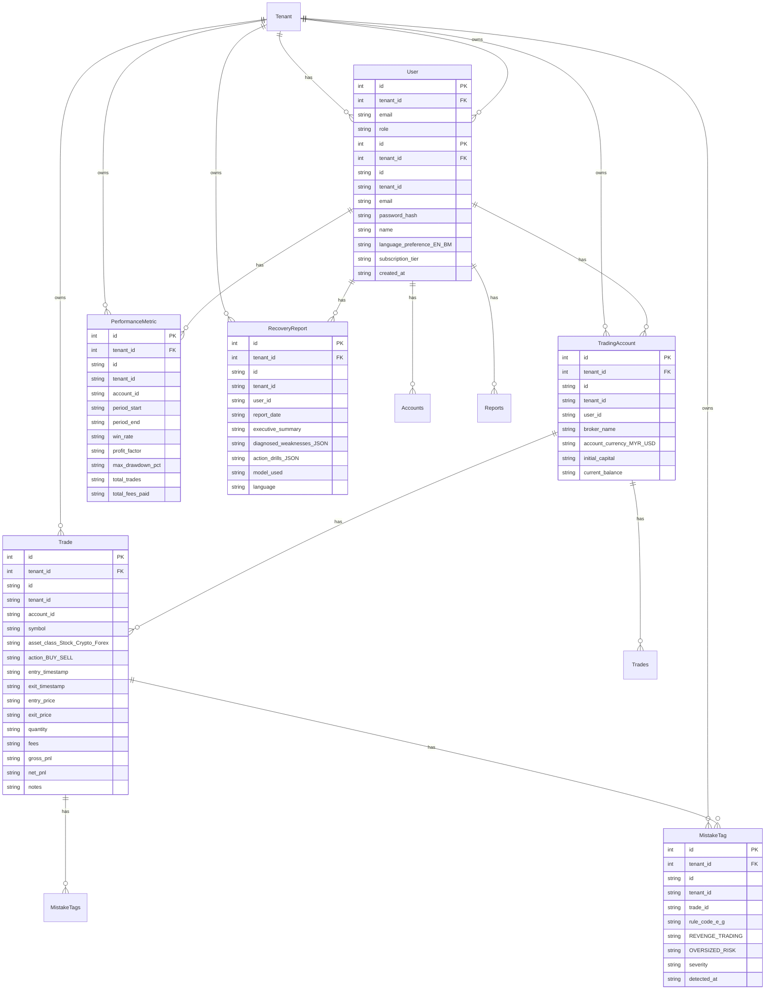

# Data model

Every table has an `id` and a `tenant_id`, and every query filters by the tenant. Add indexes for every list and search.

## User
- `id`: string
- `tenant_id`: string
- `email`: string
- `password_hash`: string
- `name`: string
- `language_preference_EN_BM`: string
- `subscription_tier`: string
- `created_at`: string
- has many Accounts
- has many Reports

## TradingAccount
- `id`: string
- `tenant_id`: string
- `user_id`: string
- `broker_name`: string
- `account_currency_MYR_USD`: string
- `initial_capital`: string
- `current_balance`: string
- belongs to User
- has many Trades

## Trade
- `id`: string
- `tenant_id`: string
- `account_id`: string
- `symbol`: string
- `asset_class_Stock_Crypto_Forex`: string
- `action_BUY_SELL`: string
- `entry_timestamp`: string
- `exit_timestamp`: string
- `entry_price`: string
- `exit_price`: string
- `quantity`: string
- `fees`: string
- `gross_pnl`: string
- `net_pnl`: string
- `notes`: string
- belongs to TradingAccount
- has many MistakeTags

## MistakeTag
- `id`: string
- `tenant_id`: string
- `trade_id`: string
- `rule_code_e_g`: string
- `REVENGE_TRADING`: string
- `OVERSIZED_RISK`: string
- `severity`: string
- `detected_at`: string
- belongs to Trade

## PerformanceMetric
- `id`: string
- `tenant_id`: string
- `account_id`: string
- `period_start`: string
- `period_end`: string
- `win_rate`: string
- `profit_factor`: string
- `max_drawdown_pct`: string
- `total_trades`: string
- `total_fees_paid`: string
- belongs to User

## RecoveryReport
- `id`: string
- `tenant_id`: string
- `user_id`: string
- `report_date`: string
- `executive_summary`: string
- `diagnosed_weaknesses_JSON`: string
- `action_drills_JSON`: string
- `model_used`: string
- `language`: string
- belongs to User

